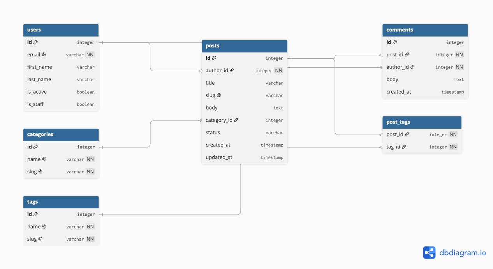

# blog-api
Django rest api

## ERD


## Queries

The `queries` command runs the ORM queries from `apps/blog/queries.py`
and shows the result and the number of SQL queries.

```bash
python manage.py queries                     # all queries except 40–44
python manage.py queries --number 31         # only query 31 (works for 40–44 too)
python manage.py queries --number 6 --sql    # also print the SQL
```

Queries 40–44 change the data. To get fresh data, run `python manage.py seed --clear`.

Example:

```
$ python manage.py queries --number 31
#31 categories_with_post_count — 1 SQL query
  Databases {'post_count': 14}
  DevOps {'post_count': 12}
  Django {'post_count': 12}
  Python {'post_count': 12}
  Security {'post_count': 11}
  (8 rows)

$ python manage.py queries --number 6 --sql
#6 has_drafts — 1 SQL query
SELECT 1 AS "a" FROM "blog_post" WHERE "blog_post"."status" = 'draft' LIMIT 1
  True
```
